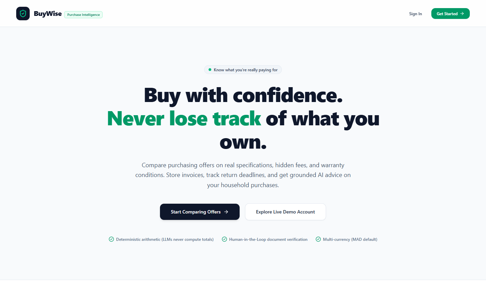
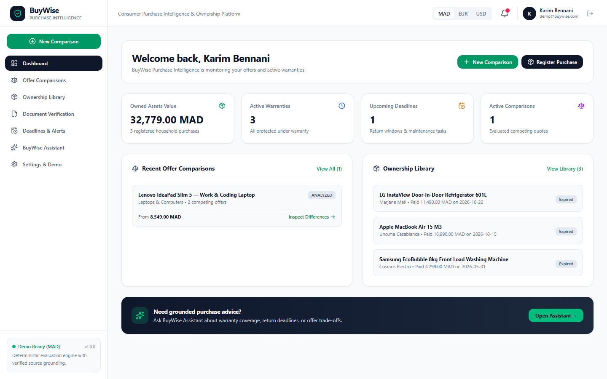
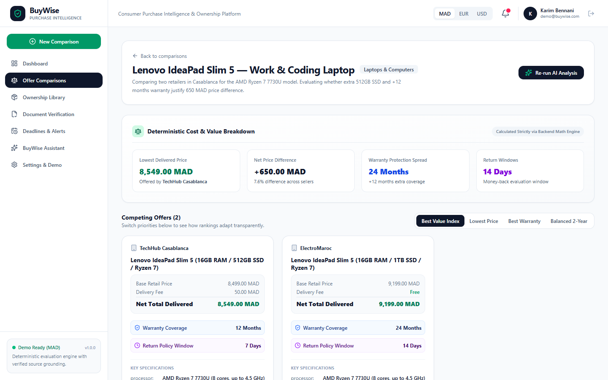
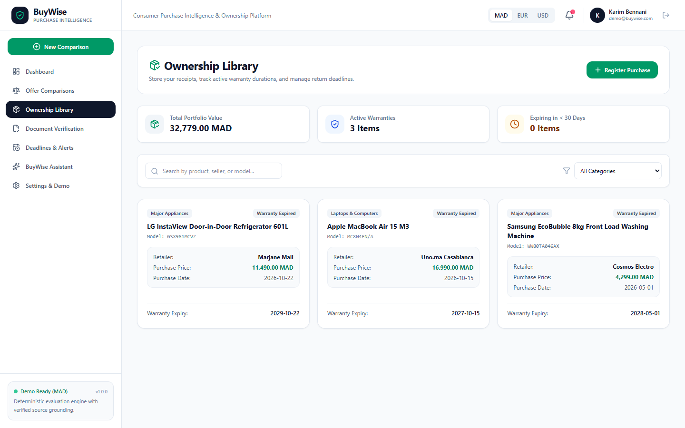
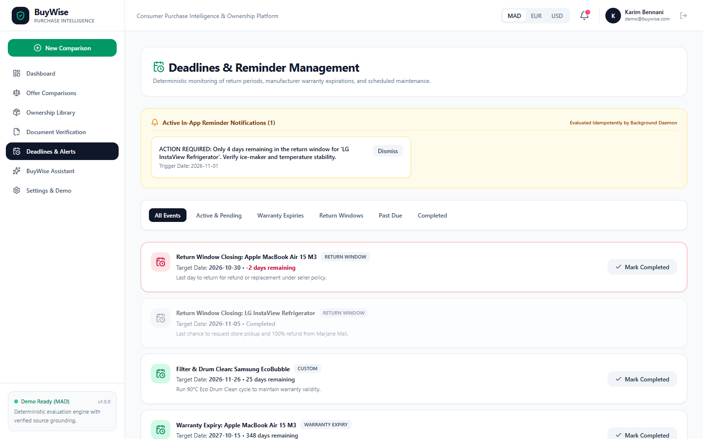
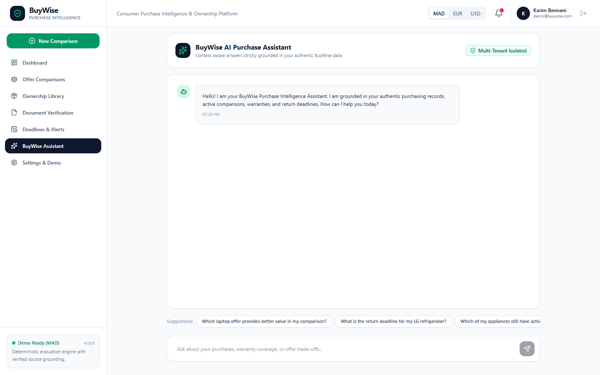
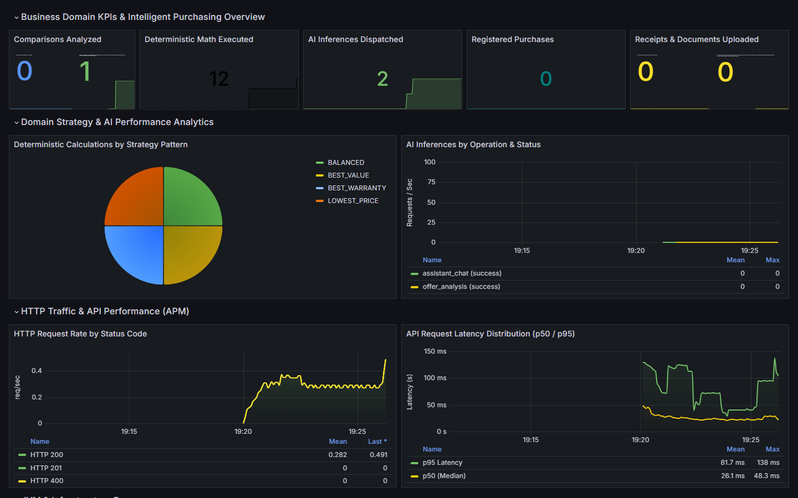
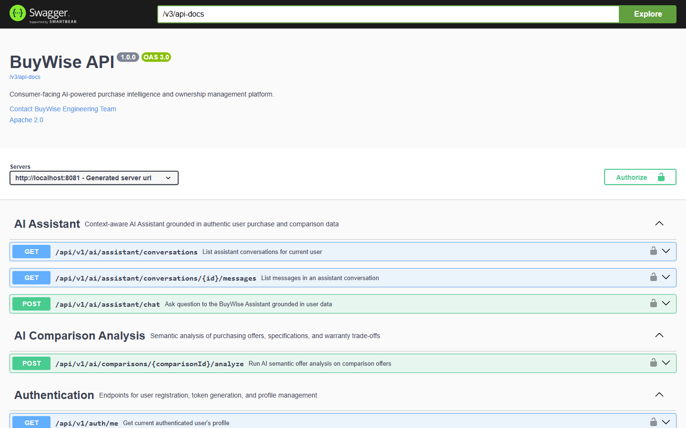
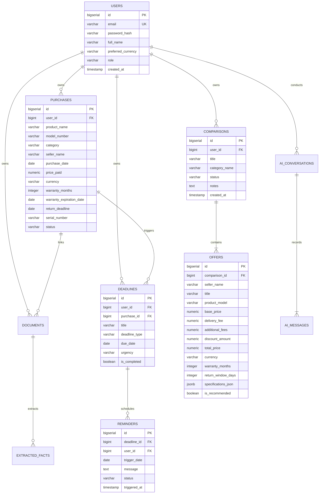

# BuyWise — Consumer Purchase Intelligence & Ownership Platform

[](https://openjdk.org/)
[](https://spring.io/projects/spring-boot)
[](https://react.dev/)
[](https://www.typescriptlang.org/)
[](https://tailwindcss.com/)
[](https://www.postgresql.org/)
[](https://prometheus.io/)
[](https://grafana.com/)
[](https://www.docker.com/)
[](https://opensource.org/licenses/MIT)

> **"Buy with confidence. Know what you're really paying for."**

BuyWise is a production-grade full-stack platform that helps ordinary consumers make smarter purchasing decisions and manage products throughout their ownership lifecycle. It bridges deterministic algebraic precision with grounded generative artificial intelligence.

---

## 📸 Platform & Operational Visual Showcase

### 1. Consumer Landing & Discovery


### 2. Consumer Executive Dashboard


### 3. Side-by-Side Offer Comparison & Grounded AI Analysis


### 4. Ownership & Active Warranty Tracking Library


### 5. Return Deadlines & Idempotent Alerts Timeline


### 6. Context-Aware Grounded AI Purchase Assistant


### 7. Real-Time Operational & Business Metrics (Grafana)


### 8. Interactive OpenAPI / Swagger Documentation


---

## 💡 Functional Architecture & Core Workflows

### Workflow A: Purchasing Offer Comparison
When buying electronics or household appliances (laptops, refrigerators, TVs, washing machines), consumers input competing offers manually or via URL. The system captures product model, seller, base price, delivery fee, surcharges, discounts, warranty length, return window, and technical specifications.

### Workflow B: Intelligent Offer Analysis (Grounded AI)
Rather than simply declaring the cheapest offer the winner, the AI analyzes qualitative trade-offs. Using Groq's high-throughput `openai/gpt-oss-20b` (with automated fallback to `openai/gpt-oss-120b`), it highlights specification differences (e.g. 512GB vs 1TB SSD, 12 vs 24 mo warranty), identifies missing specs, detects return policy risks (e.g. store credit only), and provides personalized recommendations for different buyer personas.

### Workflow C: Deterministic Total Cost & Value Engine
- **Non-Negotiable Invariant**: The LLM is **never** permitted to calculate prices, delivery fees, percentage differences, or warranty months.
- All arithmetic is calculated deterministically via `BigDecimal` in the Spring Boot backend.
- Offers are evaluated across **4 Strategy Pattern Algorithms**:
  - `LOWEST_PRICE`: Ranks strictly by bottom-line checkout cost.
  - `BEST_WARRANTY`: Maximizes manufacturer warranty duration.
  - `BEST_VALUE`: Evaluates hardware specifications per Dirham/Dollar spent.
  - `BALANCED`: Multi-criteria composite score balancing cost, warranty, and return conditions.

### Workflow D: Purchase & Ownership Management
After purchasing, users save items into their permanent Ownership Library. Products store purchase dates, sellers, invoices, serial numbers, warranty expiration dates, and return deadlines. Items remain permanently in the library even after warranty expiration.

### Workflow E: Intelligent Document Understanding & Human-in-the-Loop Review
Users upload receipts, invoices, and warranty cards. The pipeline extracts key facts (product name, price, purchase date, warranty terms, exclusions). Every fact retains its **verbatim source text excerpt** and starts in `DRAFT` status. The user explicitly reviews, corrects, or confirms facts before they become trusted ownership records.

### Workflow F: Deterministic Deadline & Idempotent Reminder Management
Tracks approaching return windows and warranty expirations. The background scheduler service tracks dispatched alerts in PostgreSQL (`(deadline_id, trigger_date)` unique constraint), ensuring that application restarts never generate duplicate notifications.

### Workflow G: Context-Aware AI Purchase Assistant
A conversational assistant grounded strictly in the authenticated user's database records. Answers questions like *"Which of my purchases still have active warranties?"* with exact dates and citations, refusing to hallucinate outside the user's data.

---

## 🏛️ System Design & Technology Stack Rationales

```
buywise/
├── backend/                   # Spring Boot 3.3.5 / Java 21 Monolith
│   ├── src/main/java/com/buywise/
│   │   ├── common/            # Security (JWT), Auditing, Metrics (Micrometer), Exceptions
│   │   └── modules/           # Auth, User, Comparison, Purchase, Document, Deadline, AI
│   └── pom.xml                # Maven Dependencies & Plugins
├── frontend/                  # React 19 / TypeScript / Tailwind CSS v4
│   ├── src/
│   │   ├── api/               # Typed REST Client
│   │   ├── context/           # AuthContext (JWT) & CurrencyContext (MAD/EUR/USD)
│   │   ├── pages/             # 11 Consumer-Facing Responsive Views
│   │   └── test/              # Vitest Automated Test Suite
│   └── package.json
├── prometheus/                # Prometheus Scrape Configuration
├── grafana/                   # Automated Provisioning (Datasources & Dashboards)
├── docs/                      # Comprehensive Guides (SRS, Architecture, Concepts)
├── docker-compose.yml         # 5 Container Orchestration (Postgres, Backend, Frontend, Prometheus, Grafana)
└── .github/workflows/ci.yml   # Multi-Stage CI Pipeline
```

### Why Java 21 & Spring Boot 3.3.5?
- **Deterministic Math & Financial Precision**: Java's `BigDecimal` offers predictable rounding modes (`RoundingMode.HALF_UP`), eliminating IEEE-754 floating-point inaccuracies.
- **Enterprise-Grade Type Safety & Encapsulation**: Strong typing guarantees rigid architectural boundaries between domain aggregates.
- **Stateless Security**: Spring Security with custom JWT filters enables true stateless authentication without session affinity overhead.
- **Production Observability**: Built-in Micrometer integration exposes JVM internals and custom domain metrics with zero friction.

### Why React 19, TypeScript & Tailwind CSS v4?
- **TypeScript Strict Mode**: Shared domain models between backend DTOs and frontend views eliminate runtime serialization bugs.
- **Multi-Currency Context**: Reactive Context API recalculates values dynamically between Moroccan Dirham (MAD), Euros (EUR), and US Dollars (USD) without page reloads.
- **Tailwind CSS v4 & Lucide Icons**: Ultra-lightweight styling engine with accessible, clean design without heavy third-party UI libraries.

### Why PostgreSQL 16 & Boyce-Codd Normal Form (BCNF)?
- **ACID Transaction Guarantees**: Prevents orphaned comparison offers, duplicate reminders, and inconsistent ownership states.
- **Structured JSONB Capability**: Stores flexible AI analysis payloads and multi-attribute product specs while maintaining strict relational foreign key constraints.

### Why Groq Cloud LLM (`openai/gpt-oss-20b` / `120b`)?
- **Sub-Second Token Inference**: Average response latency of 1.5s for structured JSON reasoning.
- **Native JSON Mode**: Strict grammar enforcement (`response_format: { type: "json_object" }`).
- **Resilience**: Client features exponential backoff with randomized jitter on HTTP 429/503 and automated fallback between 20B and 120B models.

### Why Prometheus & Grafana?
- **Prometheus**: Pull-based scraping of `/actuator/prometheus` provides real-time dimensional monitoring of JVM metrics, HTTP latency percentiles, and custom business KPIs.
- **Grafana**: Automated file-based provisioning enables immediate, out-of-the-box visibility into system health, AI execution times, and comparison strategy usage without manual configuration.

---

## 🧼 Clean Code, SOLID & Design Patterns

A complete in-depth defense is documented in [`docs/ENGINEERING_CONCEPTS.md`](file:///c:/Users/HP/Collections/VsCode%20Projects/buyWise/docs/ENGINEERING_CONCEPTS.md).

### 1. Clean Code Implementation & Justification
- **Meaningful Names & Domain Ubiquitous Language**: Method names reflect exact domain semantics (`calculateSummary`, `registerPurchaseDeadlines`, `verifyFact`) rather than generic CRUD terminology.
- **Small, Single-Purpose Functions**: Functions average under 20 lines of code, adhering to single levels of abstraction.
- **No Side Effects in Read Operations**: Queries are marked `@Transactional(readOnly = true)`, disabling Hibernate dirty-checking and preventing unintentional entity state modifications.
- **Centralized Exception Handling**: [`GlobalExceptionHandler`](file:///c:/Users/HP/Collections/VsCode%20Projects/buyWise/backend/src/main/java/com/buywise/common/exception/GlobalExceptionHandler.java) intercepts all exceptions, returning standardized RFC 7807 problem details.

### 2. SOLID Principles with Code References
| Principle | Implementation Reference | Architectural Justification |
|---|---|---|
| **S — Single Responsibility** | [`ComparisonEngineService`](file:///c:/Users/HP/Collections/VsCode%20Projects/buyWise/backend/src/main/java/com/buywise/modules/comparison/service/ComparisonEngineService.java) | Computes strictly deterministic arithmetic. Never touches LLMs or multipart files. |
| **O — Open/Closed** | [`ComparisonStrategy`](file:///c:/Users/HP/Collections/VsCode%20Projects/buyWise/backend/src/main/java/com/buywise/modules/comparison/strategy/ComparisonStrategy.java) | New ranking strategies can be added by implementing the interface without modifying existing code. |
| **L — Liskov Substitution** | [`LowestPriceStrategy`](file:///c:/Users/HP/Collections/VsCode%20Projects/buyWise/backend/src/main/java/com/buywise/modules/comparison/strategy/LowestPriceStrategy.java), [`BestWarrantyStrategy`](file:///c:/Users/HP/Collections/VsCode%20Projects/buyWise/backend/src/main/java/com/buywise/modules/comparison/strategy/BestWarrantyStrategy.java), etc. | All strategies fulfill the contract interchangeably without unexpected exceptions. |
| **I — Interface Segregation** | [`LlmProvider`](file:///c:/Users/HP/Collections/VsCode%20Projects/buyWise/backend/src/main/java/com/buywise/modules/ai/provider/LlmProvider.java) | Focused interface exposing only completion and structured output methods. |
| **D — Dependency Inversion** | [`OfferAnalysisAiService`](file:///c:/Users/HP/Collections/VsCode%20Projects/buyWise/backend/src/main/java/com/buywise/modules/ai/service/OfferAnalysisAiService.java) | Depends on the abstract `LlmProvider` interface, decoupling core logic from the Groq SDK. |

### 3. Design Patterns
- **Strategy Pattern**: [`ComparisonStrategy`](file:///c:/Users/HP/Collections/VsCode%20Projects/buyWise/backend/src/main/java/com/buywise/modules/comparison/strategy/ComparisonStrategy.java) with 4 interchangeable evaluation algorithms.
- **Factory Pattern**: [`ComparisonStrategyFactory`](file:///c:/Users/HP/Collections/VsCode%20Projects/buyWise/backend/src/main/java/com/buywise/modules/comparison/strategy/ComparisonStrategyFactory.java) dynamically resolves strategies via an internal `EnumMap`.
- **Builder Pattern**: Lombok `@Builder` on domain models and DTOs ensures immutable, readable object construction.
- **Repository Pattern**: Spring Data JPA repositories with multi-tenant isolation (`findByIdAndUserId`).

### 4. Dependency Injection & Spring IoC
- **Strict Constructor Injection**: All dependencies are injected via constructor arguments (`@RequiredArgsConstructor`), completely avoiding brittle field injection (`@Autowired` on private fields).
- **Testability**: Services can be instantiated directly in unit tests using mock objects (`MockitoExtension`) without requiring the Spring test context.

---

## 🗄️ Relational Data Model & BCNF Justification

### Database Entity Relationship Diagram (ERD)



### Boyce-Codd Normal Form (BCNF) Analysis
1. **1NF**: All table columns hold atomic, scalar values. Primary keys are defined for all relations.
2. **2NF**: No partial dependencies exist on any composite primary key.
3. **3NF**: No transitive functional dependencies exist ($X \to Y$ and $Y \to Z$). Verified categories and retailer metadata are normalized.
4. **BCNF**: For every functional dependency $X \to Y$, $X$ is a superkey. In `users`, `email` is enforced unique at the database engine level (`UK`), ensuring it is a candidate key. In all other relations, dependencies are determined solely by surrogate primary keys (`id`).

---

## 📊 Observability: Prometheus & Grafana Metrics

BuyWise exposes operational and custom business metrics via Micrometer and Prometheus Actuator:

### Key Metrics Scraped & Visualized:
- **`buywise_comparisons_analyzed_total`**: Number of purchasing comparisons analyzed by AI.
- **`buywise_deterministic_calculations_total`**: Counter tagged by strategy (`LOWEST_PRICE`, `BEST_WARRANTY`, `BEST_VALUE`, `BALANCED`).
- **`buywise_ai_requests_total`**: Counter tagged by operation (`offer_analysis`, `assistant_chat`) and status (`success`, `fallback`).
- **`buywise_ai_duration_seconds`**: Timer tracking LLM inference latency.
- **`buywise_purchases_total`**: Counter of registered consumer purchases.
- **`http_server_requests_seconds_count`**: HTTP throughput broken down by status code (2xx, 4xx, 5xx).
- **`jvm_memory_used_bytes` / `jvm_memory_max_bytes`**: Real-time JVM heap allocation.
- **`process_cpu_usage`**: CPU utilization of the Spring Boot application container.

---

## 🔑 Demo Credentials & Quick Access

The platform comes pre-seeded with Moroccan retail scenarios and sample purchases:

| Account Type | Email | Password | Role | Quick Access |
|---|---|---|---|---|
| **Demo Consumer** | `demo@buywise.com` | `Demo123!` | Standard Consumer | One-click button on login page |
| **System Admin** | `admin@buywise.com` | `Admin123!` | Administrator | Standard login |

### Live Endpoints & Port Map:
- **Web Application**: [http://localhost:3001](http://localhost:3001)
- **Backend API**: [http://localhost:8081/api/v1](http://localhost:8081/api/v1)
- **Interactive Swagger UI**: [http://localhost:8081/swagger-ui.html](http://localhost:8081/swagger-ui.html)
- **Application Health Probe**: [http://localhost:3001/api/v1/health](http://localhost:3001/api/v1/health)
- **Prometheus Server**: [http://localhost:9090](http://localhost:9090)
- **Grafana Metrics Dashboard**: [http://localhost:3002/d/buywise-overview](http://localhost:3002/d/buywise-overview) *(Anonymous admin access enabled)*

---

## 🚀 How to Run the Application

### Option A: Complete Docker Compose Stack (One Command)
```bash
docker compose up --build -d
```
Starts PostgreSQL 16, Spring Boot Backend, React Frontend, Prometheus, and Grafana.

### Option B: Local Development
1. **Database**:
   ```bash
   docker run --name buywise-postgres -e POSTGRES_DB=buywise -e POSTGRES_USER=buywise -e POSTGRES_PASSWORD=buywise_pass -p 5432:5432 -d postgres:16-alpine
   ```
2. **Backend**:
   ```bash
   cd backend
   mvn spring-boot:run
   ```
3. **Frontend**:
   ```bash
   cd frontend
   npm install
   npm run dev
   ```

---

## 🧪 Automated Test Coverage Report

### Backend Test Suite (18 / 18 Passed)
```bash
cd backend
mvn test
```
- [`ComparisonEngineServiceTest`](file:///c:/Users/HP/Collections/VsCode%20Projects/buyWise/backend/src/test/java/com/buywise/modules/comparison/service/ComparisonEngineServiceTest.java): Deterministic arithmetic invariant, `BigDecimal` scale handling, percentage difference calculations.
- [`LowestPriceStrategyTest`](file:///c:/Users/HP/Collections/VsCode%20Projects/buyWise/backend/src/test/java/com/buywise/modules/comparison/service/ComparisonEngineServiceTest.java): Delivery fees and discounts factored into rank 1.
- [`BestWarrantyStrategyTest`](file:///c:/Users/HP/Collections/VsCode%20Projects/buyWise/backend/src/test/java/com/buywise/modules/comparison/service/ComparisonEngineServiceTest.java): Warranty length prioritization.
- [`BestValueScoreStrategyTest`](file:///c:/Users/HP/Collections/VsCode%20Projects/buyWise/backend/src/test/java/com/buywise/modules/comparison/service/ComparisonEngineServiceTest.java): Spec-per-dirham score calculation.
- [`StructuredOutputValidatorTest`](file:///c:/Users/HP/Collections/VsCode%20Projects/buyWise/backend/src/test/java/com/buywise/modules/ai/service/StructuredOutputValidatorTest.java): JSON extraction, schema conformity, markdown code block stripping, and fallback handling.
- [`ComparisonSecurityIntegrationTest`](file:///c:/Users/HP/Collections/VsCode%20Projects/buyWise/backend/src/test/java/com/buywise/ComparisonSecurityIntegrationTest.java): Verifies multi-tenant user isolation.
- [`AuthControllerIntegrationTest`](file:///c:/Users/HP/Collections/VsCode%20Projects/buyWise/backend/src/test/java/com/buywise/AuthControllerIntegrationTest.java): User registration, JWT issuance, password hashing verification.

### Frontend Vitest Suite (7 / 7 Passed)
```bash
cd frontend
npm test
```
- [`CurrencyContext.test.tsx`](file:///c:/Users/HP/Collections/VsCode%20Projects/buyWise/frontend/src/test/CurrencyContext.test.tsx): Dynamic multi-currency switching across MAD, EUR, and USD.
- [`AuthContext.test.tsx`](file:///c:/Users/HP/Collections/VsCode%20Projects/buyWise/frontend/src/test/AuthContext.test.tsx): Authentication lifecycle and token storage.
- [`LandingPage.test.tsx`](file:///c:/Users/HP/Collections/VsCode%20Projects/buyWise/frontend/src/test/LandingPage.test.tsx): Consumer landing page components and navigation.
- [`LoginPage.test.tsx`](file:///c:/Users/HP/Collections/VsCode%20Projects/buyWise/frontend/src/test/LoginPage.test.tsx): Login submission and one-click demo login.

---

## 🔄 GitHub Actions CI/CD Pipeline

The automated CI workflow is configured in [`.github/workflows/ci.yml`](file:///c:/Users/HP/Collections/VsCode%20Projects/buyWise/.github/workflows/ci.yml):
1. **Backend Job**: Sets up JDK 21 Temurin, caches Maven dependencies, compiles 122 classes, and executes 18 unit/integration tests.
2. **Frontend Job**: Sets up Node.js 20, runs `npm ci`, executes Vitest test suite, and builds production Vite bundle (`tsc && vite build`).
3. **Docker Build Job**: Builds and verifies Docker container images for both backend and frontend.

---

## 📚 Complete Documentation Suite

- [**Software Requirements Specification (SRS)**](docs/SRS.md): IEEE 830-compliant specification covering all functional requirements, use cases, and NFRs.
- [**System Architecture Documentation**](docs/ARCHITECTURE.md): C4 diagrams, ERD, data isolation, and AI boundary guardrails.
- [**Software Engineering Concepts & Patterns**](docs/ENGINEERING_CONCEPTS.md): OOP pillars, SOLID principles with code references, Strategy, Factory, and Repository patterns.
- [**Technical Interview Defense Guide**](docs/INTERVIEW_GUIDE.md): Architectural decisions, trade-offs, security, and scalability defense.
- [**REST API Reference Guide**](docs/API_GUIDE.md): Complete endpoint documentation with JSON request/response examples.
- [**Evaluator Demo Walkthrough**](docs/DEMO_GUIDE.md): Step-by-step walkthrough of all 7 core workflows.

---

## 📄 License
This project is licensed under the MIT License.
