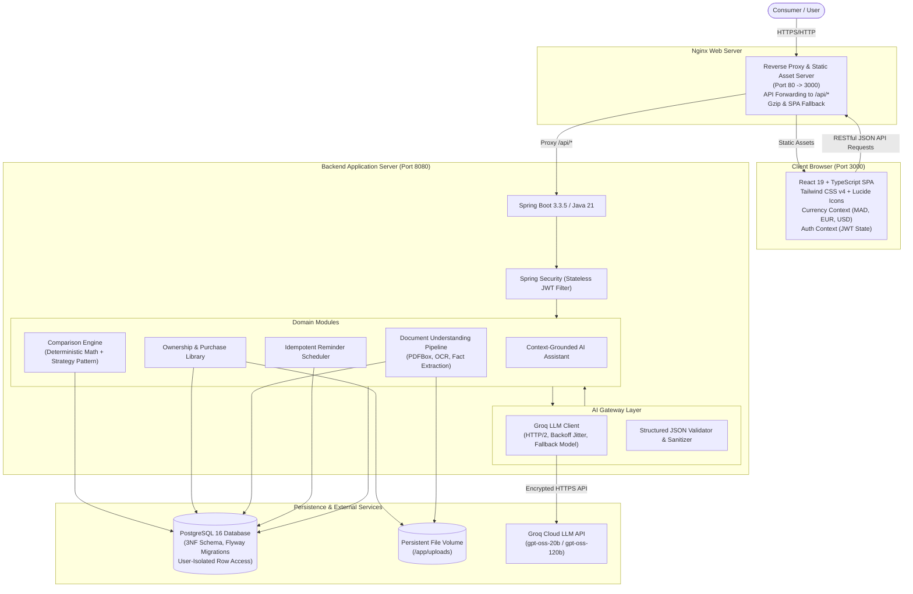
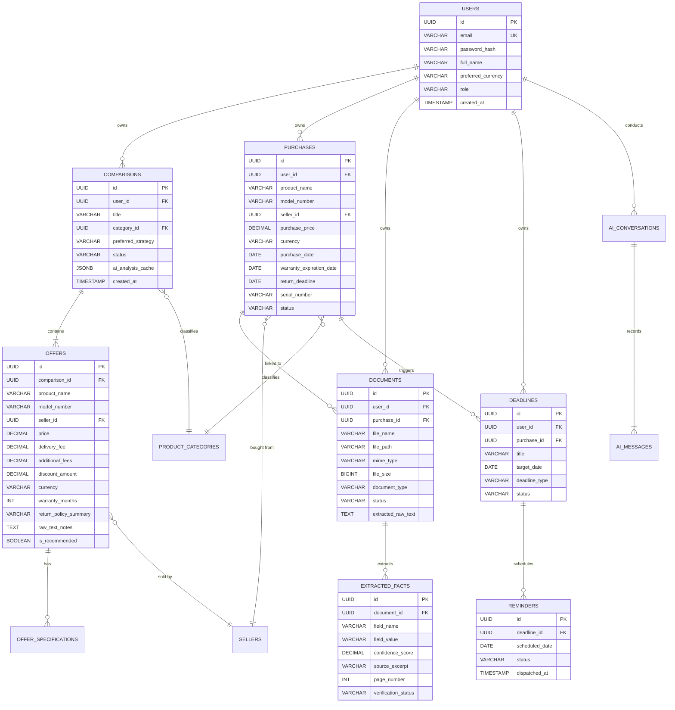

# BuyWise System Architecture Documentation

This document describes the end-to-end architecture of **BuyWise**, a consumer-facing purchase intelligence and ownership management platform.

---

## 1. High-Level Architecture (C4 Container View)



---

## 2. Component Architecture

### 2.1 Backend (Spring Boot 3.3.5 / Java 21)
The backend follows a layered, hexagonal-inspired architecture with explicit package boundaries:

- `com.buywise.common`: Shared infrastructure, security filters, cross-cutting configurations, exception handlers, and security context utilities.
- `com.buywise.domain.auth`: User registration, authentication, JWT token issuance, and password encoding.
- `com.buywise.domain.user`: User aggregate, roles (`ROLE_USER`, `ROLE_ADMIN`), profile updates, and currency preferences.
- `com.buywise.domain.comparison`: Offer comparison aggregates, offer specifications, deterministic math engine, and ranking strategies (`LowestPriceStrategy`, `BestWarrantyStrategy`, `BestValueScoreStrategy`, `BalancedPerformanceStrategy`).
- `com.buywise.domain.purchase`: Ownership library, purchase recording, warranty tracking, and invoice linkages.
- `com.buywise.domain.document`: Multi-format document ingestion, storage, text extraction, and extracted fact entities.
- `com.buywise.domain.deadline`: Deadlines, scheduled reminders, and background scheduler service.
- `com.buywise.domain.catalog`: Product categories and verified retailer catalog.
- `com.buywise.ai.provider`: LLM gateway abstraction (`LlmProvider`) and Groq implementation with retry/fallback logic.
- `com.buywise.ai.service`: High-level AI orchestrators (`OfferAnalysisAiService`, `DocumentUnderstandingAiService`, `AiAssistantService`).
- `com.buywise.ai.validator`: Structured JSON parsing, schema validation, and guardrails against ungrounded hallucinations.

### 2.2 Frontend (React 19 / TypeScript / Vite / Tailwind CSS v4)
The frontend is a single-page application built for consumer clarity:

- **State Management & Contexts**:
  - `AuthContext`: Manages active JWT tokens, user profiles, login, registration, and one-click demo login.
  - `CurrencyContext`: Handles real-time currency conversion and formatting across Moroccan Dirham (MAD), Euros (EUR), and US Dollars (USD).
- **Navigation & Views**:
  - `LandingPage`: Consumer-facing hero, feature showcase, and interactive demo triggers.
  - `DashboardPage`: Overview metrics, recent comparisons, upcoming deadlines, and quick action cards.
  - `ComparisonsListPage` & `NewComparisonPage`: Multi-offer builder with manual inputs, specification attributes, and comparison strategies.
  - `ComparisonDetailsPage`: Visual side-by-side spec comparison, deterministic cost breakdown, AI semantic analysis, risk warnings, and grounded recommendations.
  - `PurchaseLibraryPage`: Ownership registry displaying active warranties, return deadlines, and attached purchase receipts.
  - `DocumentLibraryPage` & `DocumentVerificationPage`: Human-in-the-Loop fact review interface with verbatim document source text excerpts and verification toggles.
  - `DeadlinesPage`: Visual timeline of upcoming return deadlines, warranty expirations, and idempotent reminders.
  - `AiAssistantPage`: Conversational AI purchase advisor grounded strictly in the authenticated user's comparisons and purchases.
  - `SettingsPage`: System profile and demo database reset triggers.

---

## 3. Database Schema & Entity Relationship Diagram (ERD)

The database schema is managed via Flyway (`V1__init_schema.sql` and `V2__seed_demo_data.sql`) in Third Normal Form (3NF) with strict foreign key constraints, cascade rules, and indexes:



---

## 4. Multi-Tenant User Data Isolation

BuyWise implements strict multi-tenancy at the software and query levels:

1. **Authentication Token**: The stateless JWT token contains the user's UUID in the `sub` claim.
2. **Context Resolution**: Every request extracts `userId` via `SecurityUtils.getCurrentUserId()`.
3. **Repository Guardrails**: Every query mutating or querying sensitive consumer data explicitly filters by `userId`:
   ```java
   @Query("SELECT c FROM Comparison c WHERE c.id = :id AND c.user.id = :userId")
   Optional<Comparison> findByIdAndUserId(UUID id, UUID userId);
   ```
4. **AI Context Isolation**: The AI assistant only receives context from purchases and comparisons matching the authenticated `userId`. Under no circumstances can user A inspect or ask about user B's documents or purchases.

---

## 5. Reliable AI Integration Architecture

### 5.1 Provider Gateway & Fault Tolerance
- **Model Selection**: Uses Groq's high-throughput `openai/gpt-oss-20b` for sub-second structured JSON reasoning, with seamless fallback to `openai/gpt-oss-120b` if capacity limits occur.
- **Resilience**: Implements exponential backoff with randomized jitter on HTTP `429 (Too Many Requests)` and `503 (Service Unavailable)`.
- **Stateless Prompts**: Every prompt is deterministic and fully grounded in user-provided entities.

### 5.2 Structured Output Guardrails
- LLM outputs are forced into strict JSON syntax via Groq's `response_format: { type: "json_object" }`.
- The [`StructuredOutputValidator`](file:///c:/Users/HP/Collections/VsCode%20Projects/buyWise/backend/src/main/java/com/buywise/modules/ai/service/StructuredOutputValidator.java) performs schema conformity checks, stripping accidental markdown code blocks and validating required fields.

### 5.3 Human-in-the-Loop Document Verification
When a user uploads a document:
1. Text is extracted deterministically (PDFBox / text parser).
2. AI extracts key facts (purchase price, warranty duration, return period, exclusions).
3. Every fact is saved with status `DRAFT`, storing the exact `source_excerpt` verbatim from the document.
4. The user reviews the facts in the `DocumentVerificationPage`. Only when confirmed or edited by the user does the fact update the verified `Purchase` record.
