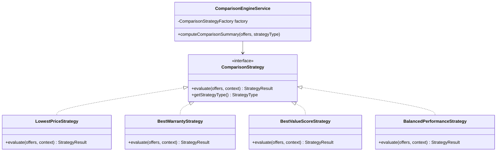
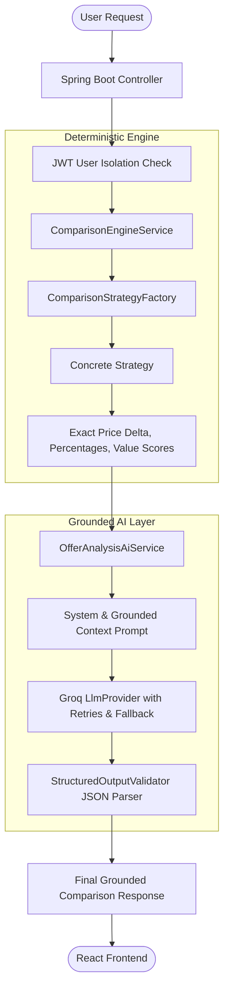

# BuyWise Engineering Concepts & Architectural Patterns

This document details the software engineering principles, design patterns, and architectural decisions implemented throughout the **BuyWise** platform.

---

## 1. Object-Oriented Programming (OOP) Pillars

BuyWise is architected with strict adherence to classical OOP principles in both Java 21 and TypeScript:

### 1.1 Encapsulation
- **Data Protection**: Domain entities (e.g., [`User`](file:///c:/Users/HP/Collections/VsCode%20Projects/spp/backend/src/main/java/com/buywise/domain/user/entity/User.java), [`Comparison`](file:///c:/Users/HP/Collections/VsCode%20Projects/spp/backend/src/main/java/com/buywise/domain/comparison/entity/Comparison.java), [`Purchase`](file:///c:/Users/HP/Collections/VsCode%20Projects/spp/backend/src/main/java/com/buywise/domain/purchase/entity/Purchase.java)) declare all fields as `private`. Internal state mutations occur through controlled methods or builder constructs.
- **DTO Boundaries**: Internal JPA entity structures are never leaked directly to HTTP clients. Request and response DTOs strictly encapsulate the public contract (e.g., [`ComparisonRequestDto`](file:///c:/Users/HP/Collections/VsCode%20Projects/spp/backend/src/main/java/com/buywise/domain/comparison/dto/ComparisonRequestDto.java) and [`ComparisonResponseDto`](file:///c:/Users/HP/Collections/VsCode%20Projects/spp/backend/src/main/java/com/buywise/domain/comparison/dto/ComparisonResponseDto.java)).

### 1.2 Abstraction
- **LLM Decoupling**: High-level intelligence features depend on the [`LlmProvider`](file:///c:/Users/HP/Collections/VsCode%20Projects/spp/backend/src/main/java/com/buywise/ai/provider/LlmProvider.java) interface rather than concrete client implementations. Callers invoke `generateCompletion` or `generateStructuredJson` without knowing whether Groq, OpenAI, or a local model executes the inference.
- **Document Processing**: The [`DocumentProcessor`](file:///c:/Users/HP/Collections/VsCode%20Projects/spp/backend/src/main/java/com/buywise/domain/document/processor/DocumentProcessor.java) interface abstracts whether a file is processed via Apache PDFBox text extraction, Apache Tesseract OCR, or plain-text readers.

### 1.3 Polymorphism
- **Dynamic Ranking Strategies**: The [`ComparisonStrategy`](file:///c:/Users/HP/Collections/VsCode%20Projects/spp/backend/src/main/java/com/buywise/domain/comparison/strategy/ComparisonStrategy.java) interface provides polymorphic execution via `evaluate(List<Offer>, ComparisonContext)`. At runtime, the client selects `LOWEST_PRICE`, `BEST_WARRANTY`, `BEST_VALUE`, or `BALANCED`, executing the respective concrete strategy seamlessly.

### 1.4 Inheritance & Composition
- **Composition over Inheritance**: Services favor composition by injecting collaborating components (e.g., [`ComparisonEngineService`](file:///c:/Users/HP/Collections/VsCode%20Projects/spp/backend/src/main/java/com/buywise/domain/comparison/service/ComparisonEngineService.java) composes the `ComparisonStrategyFactory` and `StructuredOutputValidator`).
- **Base Domain Entities**: Common auditing properties (timestamps, IDs) use JPA `@MappedSuperclass` or shared value objects.

---

## 2. SOLID Principles in Practice

| Principle | BuyWise Implementation Reference |
|---|---|
| **S - Single Responsibility Principle** | [`ComparisonEngineService`](file:///c:/Users/HP/Collections/VsCode%20Projects/spp/backend/src/main/java/com/buywise/domain/comparison/service/ComparisonEngineService.java) is solely responsible for deterministic arithmetic. It does NOT invoke LLMs, send notifications, or parse multipart files. Similarly, [`GroqLlmProvider`](file:///c:/Users/HP/Collections/VsCode%20Projects/spp/backend/src/main/java/com/buywise/ai/provider/GroqLlmProvider.java) handles only HTTP communication, retry backoff, and Groq API protocols. |
| **O - Open/Closed Principle** | Adding a new comparison algorithm (e.g., `EcoFriendlyFootprintStrategy`) requires only creating a new class implementing [`ComparisonStrategy`](file:///c:/Users/HP/Collections/VsCode%20Projects/spp/backend/src/main/java/com/buywise/domain/comparison/strategy/ComparisonStrategy.java) and registering its key. No existing comparison logic is modified. |
| **L - Liskov Substitution Principle** | All implementations of `ComparisonStrategy` ([`LowestPriceStrategy`](file:///c:/Users/HP/Collections/VsCode%20Projects/spp/backend/src/main/java/com/buywise/domain/comparison/strategy/LowestPriceStrategy.java), [`BestWarrantyStrategy`](file:///c:/Users/HP/Collections/VsCode%20Projects/spp/backend/src/main/java/com/buywise/domain/comparison/strategy/BestWarrantyStrategy.java), [`BestValueScoreStrategy`](file:///c:/Users/HP/Collections/VsCode%20Projects/spp/backend/src/main/java/com/buywise/domain/comparison/strategy/BestValueScoreStrategy.java), [`BalancedPerformanceStrategy`](file:///c:/Users/HP/Collections/VsCode%20Projects/spp/backend/src/main/java/com/buywise/domain/comparison/strategy/BalancedPerformanceStrategy.java)) fulfill the behavioral contract without unexpected exceptions or side-effects. |
| **I - Interface Segregation Principle** | Interfaces are granular and tailored. Callers requiring LLM interactions use [`LlmProvider`](file:///c:/Users/HP/Collections/VsCode%20Projects/spp/backend/src/main/java/com/buywise/ai/provider/LlmProvider.java), without being forced to depend on document storage or persistence methods. |
| **D - Dependency Inversion Principle** | High-level orchestrators ([`OfferAnalysisAiService`](file:///c:/Users/HP/Collections/VsCode%20Projects/spp/backend/src/main/java/com/buywise/ai/service/OfferAnalysisAiService.java), [`DocumentUnderstandingAiService`](file:///c:/Users/HP/Collections/VsCode%20Projects/spp/backend/src/main/java/com/buywise/ai/service/DocumentUnderstandingAiService.java)) depend exclusively on abstractions (`LlmProvider`, `DocumentProcessorFactory`) injected by Spring IoC container. |

---

## 3. Design Patterns Applied

### 3.1 Strategy Pattern
- **Purpose**: Dynamically select an evaluation algorithm according to the user's purchasing priorities.
- **Classes**:
  - Interface: `ComparisonStrategy`
  - Implementations: `LowestPriceStrategy`, `BestWarrantyStrategy`, `BestValueScoreStrategy`, `BalancedPerformanceStrategy`
  - Client: `ComparisonEngineService`

### 3.2 Factory Pattern
- **Purpose**: Encapsulate object creation and strategy resolution without exposing instantiation logic.
- **Classes**:
  - [`ComparisonStrategyFactory`](file:///c:/Users/HP/Collections/VsCode%20Projects/spp/backend/src/main/java/com/buywise/domain/comparison/strategy/ComparisonStrategyFactory.java): Injects all `List<ComparisonStrategy>` beans into an internal `EnumMap<StrategyType, ComparisonStrategy>`.
  - [`DocumentProcessorFactory`](file:///c:/Users/HP/Collections/VsCode%20Projects/spp/backend/src/main/java/com/buywise/domain/document/processor/DocumentProcessorFactory.java): Inspects MIME types (`application/pdf`, `image/png`, `text/plain`) and supplies the appropriate processor instance.

### 3.3 Builder Pattern
- **Purpose**: Clean, readable construction of complex domain aggregates and immutable DTOs with numerous parameters.
- **Usage**: Lombok `@Builder` utilized on `ComparisonSummary`, `CalculatedOfferMetrics`, `FactExtractionResult`, and `StructuredPrompt`.

### 3.4 Repository Pattern
- **Purpose**: Decouple business logic from database query execution and persistence technology.
- **Classes**: Spring Data JPA repositories:
  - `ComparisonRepository`
  - `PurchaseRepository`
  - `DocumentRepository`
  - `DeadlineRepository`
  - `ExtractedFactRepository`
- **Multi-Tenant Security Enforcement**: All query methods enforce user ownership at the database query level:
  `Optional<Comparison> findByIdAndUserId(UUID id, UUID userId);`
  `List<Purchase> findByUserIdOrderByPurchaseDateDesc(UUID userId);`

---

## 4. Spring Boot Architectural Foundations

### 4.1 Dependency Injection & Inversion of Control (IoC)
- Strict **Constructor-based Injection** using Lombok `@RequiredArgsConstructor(onConstructor_ = @Autowired)`.
- Eliminates brittle field injection (`@Autowired` on private fields), ensuring classes are testable via standard unit test mocks (`MockitoExtension`).

### 4.2 Declarative Transaction Management
- Methods performing read-only queries are decorated with `@Transactional(readOnly = true)` to enable database read optimizations, disable dirty-checking overhead in Hibernate, and route to read replicas when configured.
- Mutating business operations (e.g., `saveComparison`, `verifyExtractedFact`, `recordPurchase`) use `@Transactional` to ensure atomic ACID compliance. Rollback occurs automatically on unhandled runtime exceptions.

### 4.3 Stateless Security Architecture
- Spring Security configured with `SessionCreationPolicy.STATELESS`.
- Every request carries a cryptographically signed Bearer JWT token validated by [`JwtAuthenticationFilter`](file:///c:/Users/HP/Collections/VsCode%20Projects/spp/backend/src/main/java/com/buywise/common/security/JwtAuthenticationFilter.java).
- User identity is stored in Spring's `SecurityContextHolder` (`ThreadLocal`), accessible via [`SecurityUtils.getCurrentUserId()`](file:///c:/Users/HP/Collections/VsCode%20Projects/spp/backend/src/main/java/com/buywise/common/security/SecurityUtils.java).
- Cross-Site Request Forgery (CSRF) is disabled because the application is fully stateless and does not rely on browser session cookies.

### 4.4 Idempotent Scheduled Background Tasks
- [`ReminderSchedulerService`](file:///c:/Users/HP/Collections/VsCode%20Projects/spp/backend/src/main/java/com/buywise/domain/deadline/service/ReminderSchedulerService.java) executes periodically using `@Scheduled(cron = "0 0 6 * * *")`.
- Idempotency is guaranteed by tracking reminder dispatch state in the `reminders` table with unique constraints on `(deadline_id, scheduled_date)`. System restarts or repeated executions never generate duplicate alerts.

---

## 5. Clean Separation: Deterministic Math vs. Non-Deterministic AI

A central architecture requirement of BuyWise is that **the LLM is NEVER allowed to perform arithmetic that can be computed deterministically**.

1. **Backend calculates**: Total cost, price difference, delivery surcharge, percentage savings, warranty duration in months, and deterministic value scores.
2. **LLM receives**: The pre-calculated values alongside verified raw specifications.
3. **LLM produces**: Qualitative trade-off analysis, missing spec warnings, warranty exclusions breakdown, and persona-based recommendation.
4. **Structured Validator verifies**: JSON structure, schema conformity, and validates that no unverified claims or hallucinatory arithmetic are delivered to the consumer.
