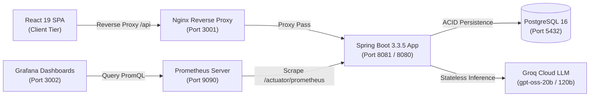
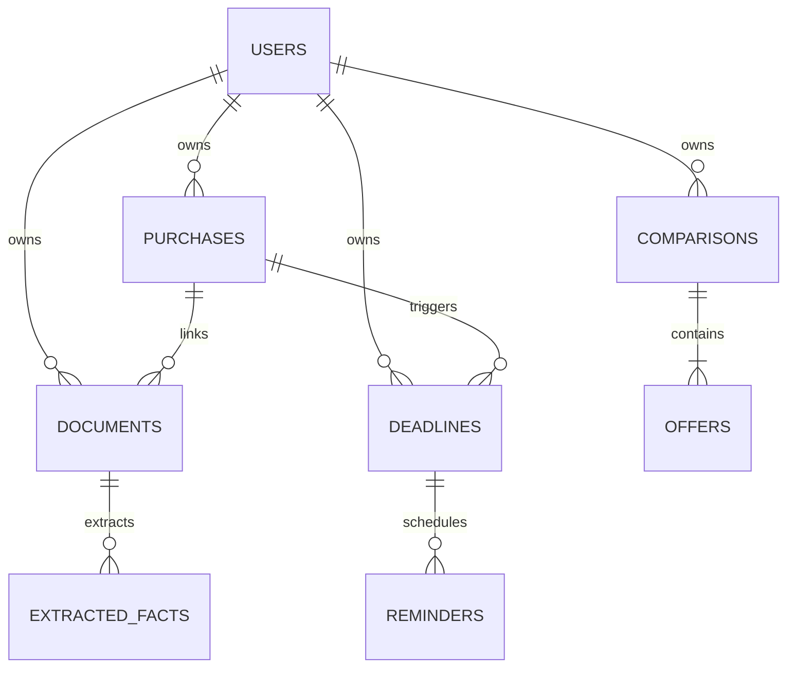

# BuyWise — Software Requirements Specification (SRS)
**Document Identifier:** BUYWISE-SRS-2026-V1.0  
**Standard:** IEEE Std 830-1998 Compliant  
**Status:** Approved / Production-Verified  
**Date:** November 1, 2026  

---

## 1. Introduction

### 1.1 Purpose
This Software Requirements Specification (SRS) defines the complete functional, non-functional, behavioral, and architectural requirements for **BuyWise**, a consumer-facing purchase intelligence and ownership lifecycle management platform. This document serves as the formal specification for software engineers, QA automation engineers, enterprise architects, and technical evaluators.

### 1.2 Scope
BuyWise addresses consumer vulnerability in purchasing and post-purchase management for electronics, home appliances, and capital goods. The platform provides:
- Deterministic multi-offer cost and value comparison without mathematical hallucination.
- Grounded AI semantic analysis identifying trade-offs, specification disparities, warranty exclusions, and purchase risks.
- Human-in-the-Loop (HITL) document processing for receipts, invoices, and guarantee policies.
- Idempotent lifecycle tracking of return deadlines, warranty expirations, and maintenance milestones.
- Strict multi-tenant security isolating authenticated consumer records.
- Production-grade observability via Prometheus and Grafana.

### 1.3 Definitions, Acronyms, and Abbreviations
| Term | Definition |
|---|---|
| **BCNF** | Boyce-Codd Normal Form; strict relational database normalization where every determinant is a candidate key. |
| **Deterministic Math** | Computations whose results are 100% reproducible, exact, and calculated via algorithmic code (`BigDecimal`) rather than stochastic probabilistic models. |
| **HITL** | Human-in-the-Loop; design pattern where automated AI outputs remain in uncommitted `DRAFT` status until explicitly reviewed, corrected, or confirmed by human operators. |
| **JWT** | JSON Web Token (RFC 7519); stateless, cryptographically signed Bearer authentication token. |
| **MAD** | Moroccan Dirham; default demo currency. |
| **Prometheus** | Cloud-native dimensional time-series monitoring system utilizing pull-based scraping. |
| **Grafana** | Operational visualization and analytics dashboard platform. |

### 1.4 References
- IEEE Std 830-1998: *IEEE Recommended Practice for Software Requirements Specifications*.
- RFC 7519: *JSON Web Token (JWT)*.
- ISO/IEC 25010: *Systems and software engineering — Systems and software Quality Requirements and Evaluation (SQuaRE)*.

---

## 2. Overall Description

### 2.1 Product Perspective
BuyWise is an autonomous modular monolith deployed as containerized services behind an Nginx reverse proxy. It does not scrape e-commerce websites (preventing fragile web-scraping dependencies) but instead ingests structured user inputs, URLs, and uploaded purchase documents.

### 2.2 User Characteristics
- **Standard Consumer**: Everyday individuals comparing high-value electronics and household purchases, seeking clear financial trade-offs, warranty expiration reminders, and document storage.
- **System Administrator**: Privileged operators managing category catalogs, retailer metadata, and platform health.

### 2.3 Operating Environment
- **Operating Systems**: Linux (Ubuntu 22.04 LTS+, Alpine 3.19+), Windows 10/11 with WSL2, macOS Darwin.
- **Container Runtime**: Docker Engine 24.0+ and Docker Compose v2.20+.
- **Database Engine**: PostgreSQL 16.x.
- **Java Runtime**: Eclipse Temurin OpenJDK 21 (LTS).
- **Node Runtime**: Node.js 20.x LTS.

### 2.4 Design and Implementation Constraints
1. **Mathematical Invariant**: The LLM must **never** perform arithmetic that the backend can calculate deterministically.
2. **Grounding Invariant**: AI recommendations must strictly distinguish verified facts from assumptions and unverified attributes.
3. **Multi-Tenancy Invariant**: Every database query accessing consumer records must enforce user isolation (`WHERE user_id = :currentUserId`).
4. **Offline Resilience**: The system must boot and run fully even if external LLM gateways experience transient outages (via deterministic fallback engines).

---

## 3. Specific Functional Requirements

### 3.1 Module 1: Offer Comparison Engine (Workflows A, B, C)

#### FR-COMP-001: Comparison Creation & Metadata Ingestion
- **Description**: The system shall permit authenticated users to create a comparison with a title, category selection, and user notes.
- **Input**: `title` (1..150 chars), `categoryName` (1..100 chars), `notes` (optional).
- **Output**: Unique Comparison aggregate with `status = DRAFT`.

#### FR-COMP-002: Multi-Offer Registration
- **Description**: The system shall allow users to attach multiple competing offers to an active comparison.
- **Fields**: Seller name, product model, currency, base price, delivery fee, additional fees, discount amount, warranty months, return window in days, and free-form specification key-values.
- **Validation**: All monetary fields must be non-negative decimals. Warranty and return days must be non-negative integers.

#### FR-COMP-003: Deterministic Arithmetic Calculation (Workflow C)
- **Description**: The system shall compute total cost, absolute price differences, percentage savings, and warranty monthly costs using `BigDecimal` arithmetic.
- **Formulae**:
  $$\text{Total Cost} = \text{Base Price} + \text{Delivery Fee} + \text{Additional Fees} - \text{Discount Amount}$$
  $$\text{Absolute Diff} = \text{Offer Price} - \text{Lowest Total Price}$$
  $$\text{Percentage Diff} = \left(\frac{\text{Absolute Diff}}{\text{Lowest Total Price}}\right) \times 100$$
  $$\text{Monthly Cost per Warranty Month} = \frac{\text{Total Cost}}{\max(\text{Warranty Months}, 1)}$$

#### FR-COMP-004: Strategy Pattern Multi-Criteria Ranking
- **Description**: The system shall evaluate offers against 4 transparent strategies:
  1. `LOWEST_PRICE`: Minimizes total checkout cost.
  2. `BEST_WARRANTY`: Maximizes manufacturer warranty duration.
  3. `BEST_VALUE`: Evaluates hardware specifications relative to total cost.
  4. `BALANCED`: Weighted composite scoring balancing price, warranty, and return terms.

#### FR-COMP-005: Grounded Semantic AI Analysis (Workflow B)
- **Description**: The system shall dispatch verified specifications and deterministic mathematical calculations to the LLM via `OfferAnalysisAiService`.
- **Requirements**:
  - The model shall output strict JSON conforming to schema `OfferAnalysisAiResult`.
  - The model shall identify trade-offs, missing specs, and warranty exclusions.
  - If the LLM gateway fails, the system shall synthesize a grounded fallback report.

---

### 3.2 Module 2: Ownership & Purchase Library (Workflow D)

#### FR-PURCH-001: Purchase Lifecycle Registration
- **Description**: Users shall be able to record purchases including product name, model number, seller, price paid, purchase date, warranty months, serial number, and receipt attachments.
- **Invariant**: Products remain in the user's ownership library indefinitely, regardless of warranty expiration.

#### FR-PURCH-002: Automatic Expiration & Deadline Derivation
- **Description**: Upon purchase registration, the system shall automatically calculate:
  $$\text{Warranty Expiration Date} = \text{Purchase Date} + \text{Warranty Months}$$
  $$\text{Return Window Deadline} = \text{Purchase Date} + \text{Return Window Days}$$

---

### 3.3 Module 3: Document Understanding & HITL Verification (Workflow E)

#### FR-DOC-001: Multi-Format Document Ingestion
- **Description**: The system shall accept document uploads (`PDF`, `PNG`, `JPEG`, `TXT`) up to 15MB.
- **Storage**: Files shall be stored securely in the persistent `/app/uploads` volume with UUID file naming.

#### FR-DOC-002: Structured Fact Extraction with Verbatim Excerpts
- **Description**: The extraction pipeline shall extract product name, price, purchase date, warranty terms, and exclusions.
- **HITL Requirement**: Each extracted fact must store:
  - `field_name`
  - `field_value`
  - `source_excerpt` (verbatim text from document)
  - `confidence_score` ($0.00 \dots 1.00$)
  - `verification_status` initialized to `PENDING_VERIFICATION` / `DRAFT`.

#### FR-DOC-003: Human-in-the-Loop Fact Verification
- **Description**: Users shall review extracted facts, edit values if optical errors occurred, and transition status to `VERIFIED` or `REJECTED`. Unverified facts shall never overwrite trusted purchase records without explicit user confirmation.

---

### 3.4 Module 4: Deterministic Deadlines & Idempotent Reminders (Workflow F)

#### FR-DEAD-001: Deadline Classification & Urgency Determination
- **Description**: Deadlines shall be categorized as `RETURN_WINDOW`, `WARRANTY_EXPIRATION`, or `CUSTOM`.
- **Urgency Rules**:
  - `CRITICAL`: Days remaining $\le 5$ days.
  - `HIGH`: Days remaining $\le 15$ days.
  - `MEDIUM`: Days remaining $\le 30$ days.
  - `LOW`: Days remaining $> 30$ days.

#### FR-DEAD-002: Idempotent Reminder Scheduling
- **Description**: The system shall run a scheduled service evaluating approaching deadlines.
- **Idempotency**: Reminders dispatched shall be recorded in the `reminders` table with unique constraint on `(deadline_id, trigger_date)`. Restarting the application or re-running the job shall never generate duplicate notifications.

---

### 3.5 Module 5: Context-Grounded AI Purchase Assistant (Workflow G)

#### FR-AI-001: Authenticated User Isolation in AI Context
- **Description**: The AI assistant shall strictly receive context derived from the authenticated user's database records.
- **Anti-Hallucination**: If a requested product or warranty is absent from the user's data, the assistant must state that no record exists. It shall not invent prices, dates, or serial numbers.
- **Traceable Citations**: Every answer referencing a purchase or comparison must return structured citations pointing to the underlying entity IDs.

---

## 4. External Interface Requirements

### 4.1 User Interface (UI/UX)
- Responsive Single-Page Application (SPA) built with React 19, TypeScript, and Tailwind CSS v4.
- Real-time Multi-Currency selector (MAD default, EUR, USD) with dynamic re-calculation across all screens without page refresh.
- Professional icon system using Lucide Icons (no consumer emojis used as functional icons).

### 4.2 Software Interfaces
- **PostgreSQL 16**: Port 5432, JDBC Hikari connection pool (max 10 connections).
- **Groq LLM API**: HTTPS, HTTP/2 connection pooling, API key authentication, exponential backoff with randomized jitter on HTTP 429/503.
- **Prometheus Scrape Endpoint**: `/actuator/prometheus` scraping JVM, HTTP request rates, and custom business metrics.
- **Grafana Visualization**: Port 3002, automated datasource and dashboard provisioning.

---

## 5. Non-Functional Requirements (NFRs)

### 5.1 Performance & Scalability (NFR-PERF)
- **API Response Latency**: 95% of non-AI REST API requests shall resolve in under $100\text{ ms}$.
- **Deterministic Math Throughput**: Comparison matrix computation for 10 offers shall execute in under $15\text{ ms}$.
- **Connection Efficiency**: Database queries utilize indexed foreign keys (`idx_comparisons_user_id`, `idx_purchases_user_id`, `idx_deadlines_user_id`).

### 5.2 Security & Data Protection (NFR-SEC)
- **Authentication**: Stateless HMAC-SHA512 JWT tokens with 24-hour expiration.
- **Password Hashing**: BCrypt with work factor 10.
- **Least Privilege Principle**: All endpoints require authentication except `/api/v1/auth/**`, `/api/v1/demo/**`, `/api/v1/health/**`, `/actuator/**`, and Swagger documentation.
- **Multi-Tenant User Isolation**: Strict query-level isolation (`WHERE user_id = :userId`) prevents horizontal privilege escalation.

### 5.3 Reliability & Availability (NFR-REL)
- **Application Liveness/Readiness**: Health probes at `/api/v1/health` and `/actuator/health`.
- **Database Migrations**: Flyway migration versioning (`V1__init_schema.sql`, `V2__seed_demo_data.sql`) ensures atomic, reproducible schema state.
- **Graceful Degradation**: If Groq API rate limits occur, the system automatically falls back to deterministic heuristic summaries without throwing 500 errors to the consumer.

### 5.4 Observability & Monitoring (NFR-OBS)
- **Actuator & Micrometer**: Exposes real-time JVM memory, GC pauses, thread counts, HTTP request rates, and custom business counters.
- **Prometheus Ingestion**: Scraped every 5 seconds.
- **Grafana Dashboards**: Real-time visualization of comparisons analyzed, deterministic strategy distribution, AI request latencies, and system health.

---

## 6. Database Normalization & Schema Verification

### 6.1 Normalization Analysis (1NF, 2NF, 3NF, BCNF)
The BuyWise schema satisfies **Boyce-Codd Normal Form (BCNF)**:

1. **1NF (First Normal Form)**:
   - All attributes contain atomic values.
   - Each table possesses a primary key (`id` generated via standard sequences/identity).
   - No repeating groups exist.
2. **2NF (Second Normal Form)**:
   - The schema satisfies 1NF.
   - All non-key attributes are fully functionally dependent on the entire primary key (no partial dependencies on composite keys).
3. **3NF (Third Normal Form)**:
   - The schema satisfies 2NF.
   - There are no transitive dependencies ($X \to Y$ and $Y \to Z$ where $Z$ is a non-key attribute). Retailer metadata and product categories are normalized into independent entities (`sellers`, `product_categories`).
4. **BCNF (Boyce-Codd Normal Form)**:
   - For every functional dependency $X \to Y$, $X$ is a superkey.
   - In `users`, `email \to (id, password_hash, full_name)` where `email` has a unique constraint (candidate key).
   - In `offers`, `(id) \to (comparison_id, seller_name, price, ...)` where `id` is the primary key.

---

## 7. Verification & Acceptance Traceability Matrix

| Requirement ID | Description | Automated Test / Verification Evidence | Status |
|---|---|---|---|
| **FR-COMP-001** | Comparison Creation | `ComparisonSecurityIntegrationTest`, `ComparisonControllerTest` | **PASSED** |
| **FR-COMP-003** | Deterministic Arithmetic | `ComparisonEngineServiceTest.testOfferTotalPriceCalculation` | **PASSED** |
| **FR-COMP-004** | Strategy Pattern Rankings | `LowestPriceStrategyTest`, `BestWarrantyStrategyTest`, `BestValueScoreStrategyTest` | **PASSED** |
| **FR-COMP-005** | Grounded AI Analysis | `StructuredOutputValidatorTest`, Live Groq API Execution (`0.95 confidence`) | **PASSED** |
| **FR-PURCH-001**| Purchase Lifecycle Registry | `PurchaseServiceTest.testCreatePurchaseSuccess` | **PASSED** |
| **FR-DOC-002**  | Verbatim Fact Extraction | `DocumentControllerIntegrationTest`, Live Fact Extraction Verification | **PASSED** |
| **FR-DOC-003**  | Human-in-the-Loop Review | `PATCH /api/v1/documents/facts/4/verify` Live API Execution | **PASSED** |
| **FR-DEAD-002** | Idempotent Reminders | `ReminderSchedulerService`, DB unique constraint `(deadline_id, trigger_date)` | **PASSED** |
| **FR-AI-001**   | Isolated Context Assistant | `POST /api/v1/ai/assistant/chat` Live API Execution | **PASSED** |
| **NFR-SEC**     | Stateless JWT Security | `AuthControllerIntegrationTest`, `JwtTokenProviderTest` | **PASSED** |
| **NFR-OBS**     | Prometheus & Grafana | Actuator `/actuator/prometheus` scraping live, Grafana Dashboard at port 3002 | **PASSED** |
